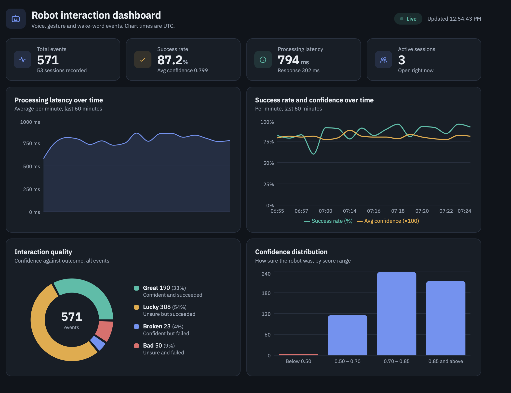

# Interaction Analytics Dashboard — Robot Logging Pipeline

A full-stack pipeline that captures robot interaction events (voice commands, gestures, wake-word triggers), stores them in MongoDB, exposes usage and quality metrics through a REST API, and visualises them in a live React dashboard.



## Project Structure

```text
robot-dashboard/
├── schema/
├── backend/
│   ├── config/
│   ├── middleware/
│   ├── models/
│   └── routes/
├── simulator/
├── frontend/
│   └── src/
└── docs/
```

- **schema/**: JSON Schema contracts for events, sessions, and API responses
- **backend/**: Express.js + MongoDB API
- **simulator/**: Python script that generates simulated robot events
- **frontend/**: React dashboard (Vite + Recharts)
- **docs/**: Screenshots

## Prerequisites

- Node.js 18+
- Python 3.9+
- MongoDB Atlas account (Free Tier supported)

## Setup

### 1. Backend

```bash
cd backend
npm install
cp .env.example .env
```

Edit the `.env` file and add your MongoDB connection string and port:

```text
MONGO_URI=mongodb+srv://<user>:<password>@<cluster-host>.mongodb.net/robot-dashboard?retryWrites=true&w=majority
PORT=3000
```

In MongoDB Atlas, make sure a database user exists and your IP address is allowed under Network Access.

### 2. Simulator

```bash
cd simulator
pip install requests
```

### 3. Frontend

```bash
cd frontend
npm install
cp .env.example .env    # optional, defaults to http://localhost:3000
```

## Running the Project

Open three terminals.

### Terminal 1 — Backend

```bash
cd backend
npm start
```

Expected output:

```text
MongoDB connected!
Server running on http://localhost:3000
```

### Terminal 2 — Simulator

```bash
cd simulator
python simulator.py
```

Press Ctrl+C to stop the simulator.

### Terminal 3 — Frontend

```bash
cd frontend
npm run dev
```

Open http://localhost:5173.

## Dashboard

The dashboard polls `GET /api/metrics` and `GET /api/quality` every 5 seconds and renders:

- Four KPI tiles: total events, success rate, processing latency, active sessions
- Processing latency over time (per minute, last 60 minutes)
- Success rate and confidence over time (per minute, last 60 minutes)
- Quality donut: great / lucky / broken / bad
- Confidence distribution across score ranges

The frontend talks to the backend only through `frontend/src/api.js`, using the response contracts in `schema/`, so it stays decoupled from the backend internals. If the backend becomes unreachable, the dashboard shows a banner and keeps the last data it received. Chart times are in UTC.

## API Endpoints

| Method | Endpoint                        | Description                                                       |
| ------ | ------------------------------- | ----------------------------------------------------------------- |
| POST   | `/api/sessions/start`           | Start a new session                                               |
| POST   | `/api/sessions/end/:session_id` | End a session and compute summaries                               |
| GET    | `/api/sessions`                 | Retrieve all sessions                                             |
| GET    | `/api/sessions/:id/events`      | Retrieve all events for a session                                 |
| POST   | `/api/events`                   | Create a new event (validated against `schema/event.schema.json`) |
| GET    | `/api/events`                   | Retrieve or filter events                                         |
| GET    | `/api/metrics`                  | Retrieve usage metrics                                            |
| GET    | `/api/quality`                  | Retrieve quality metrics                                          |

## Schema and Contracts

All event, session, and API response structures are defined in the `schema/` directory as JSON Schema Draft-07 documents.

The `POST /api/events` endpoint validates incoming payloads against `schema/event.schema.json` using **AJV** before storing them in MongoDB.

Per the schema, `processing_latency_ms` and `response_latency_ms` are `null` for `wake_word` events, and the simulator and metrics queries follow this.

## Technology Stack

- **Backend:** Node.js, Express.js
- **Database:** MongoDB Atlas
- **Validation:** AJV (JSON Schema Validation)
- **Simulator:** Python
- **Frontend:** React, Vite, Recharts

## Features

- Robot session lifecycle management
- Event ingestion and validation
- Usage analytics and metrics
- Quality monitoring endpoints
- JSON Schema–based API contracts
- Simulated robot event generation for testing
- Live React dashboard with KPI tiles, trend charts, quality donut, and confidence distribution
